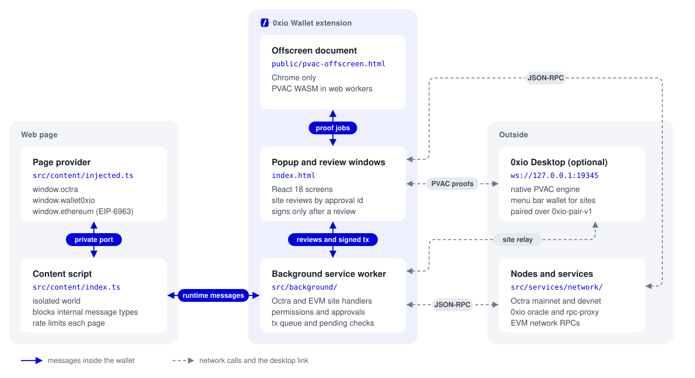

<p align="center">
  <picture>
    <source media="(prefers-color-scheme: dark)" srcset="docs/img/lockup-white.svg">
    
  </picture>
</p>

<p align="center">
  <a href="https://github.com/0xio-xyz/0xio-wallet/actions/workflows/ci.yml"></a>
  <a href="https://chromewebstore.google.com/detail/0xio-wallet/anknhjilldkeelailocijnfibefmepcc"></a>
  <a href="LICENSE"></a>
  <a href="https://x.com/0xio_xyz"></a>
</p>

# 0xio Wallet

Non-custodial browser wallet for the Octra Network with PVAC-HFHE privacy: encrypted balances, stealth transfers and range proofs, all computed on your device, plus EVM accounts from the same recovery phrase.

- **Version:** 3.0.6
- **Platform:** Chromium 111+ and Firefox 140+ (Android 142+) on Manifest V3
- **License:** [GPL-3.0-only](LICENSE)
- **Copyright:** (C) 2025-2026 0xio Labs

## Install

- [Chrome Web Store](https://chromewebstore.google.com/detail/0xio-wallet/anknhjilldkeelailocijnfibefmepcc)
- [0xio.xyz](https://0xio.xyz) for the other 0xio wallets

To run the code in this repository instead, build it from source.

## Build from source

Prerequisites: Node 22 and npm 11 (`npm i -g npm@11`; the lockfile is npm 11).

```bash
npm ci
npm run build          # Chrome  -> dist/
npm run build:firefox  # Firefox -> dist-firefox/
```

Load unpacked: Chrome -> `chrome://extensions` (Developer Mode) -> Load unpacked -> `dist/`. Firefox -> `about:debugging` -> Load Temporary Add-on -> `dist-firefox/manifest.json`.

The wallet needs no API keys: the hosted 0xio services serve wallet reads without one, limited per IP. The PVAC WASM ships prebuilt in `public/` and `src/wasm/`.

Lint, typecheck, format and test commands are in [CONTRIBUTING.md](CONTRIBUTING.md).

## Features

- **Non-custodial**: keys are generated and stored on the device (AES-256-GCM vault, PBKDF2-SHA256).
- **Encrypted balances (PVAC-HFHE)**: move OCT between a public and a homomorphically encrypted private balance; the network operates on ciphertexts it cannot read.
- **Stealth transfers**: send OCT with the recipient hidden and the amount encrypted (ECDH x25519 + PVAC); the amount is proven in range with a compact aggregated proof, and claiming scans the on-chain outputs page by page from a stored point per network and wallet (one pass on a node without paging), and re-reads each output and checks its commitment before claiming; only an output the node reads as unspent is claimed, and a dropped or released claim is resent as its saved bytes only while the output reads unspent, its nonce is still the next one and its fee is the reviewed one, else built fresh. A site claim refuses with nothing sent as `CLAIM_OUTPUT_SPENT`, `CLAIM_OUTPUT_UNREADABLE` or `CLAIM_CONFLICT`, or as `RATE_LIMIT_EXCEEDED` or `NETWORK_ERROR` after the retry window; an output already claimed here returns the earlier hash.
- **Cross-chain swap**: in-wallet OCT <-> ETH swaps backed by the 0xio solver (live quote -> lock -> fill -> settle).
- **EVM**: a 0x address per account from the same phrase (m/44'/60'/0'/0/i) on Ethereum, Robinhood Chain and any network you add: balances, ERC-20 import, send with a live fee and a review, token charts (DefiLlama), history beside Octra's (Blockscout through the 0xio oracle, or an added network's own Blockscout explorer) with contract calls read by action and contract on both, and an EIP-1193 and EIP-6963 provider for websites.
- **Bridge**: OCT <-> wOCT inside the wallet (bridge to Ethereum and claim, or bridge back to Octra), any chain to OCT through Relay, and transfers read back from the chains. Every step has its own review, and the Octra network fee is read live.
- **NFTs**: every held collection without an import step (Import for the rest), newest pieces, hide with Undo, Xpectrum list and change price, XSN-1 and Biont collections, and sandboxed EUINT living NFTs.
- **Names (ONS)**: on a network with an ONS contract (devnet today): send to `name.oct` by picking the resolved address, with the name read again before signing; primary names shown beside addresses; names held show in NFTs with their own artwork read from `token_uri` like any NFT (a plate drawn by the wallet only when the artwork cannot be loaded), an Expired tag once expired, and Transfer while active. The contract address is read from the token-lists name list (`octra.namelist.json`) and checked on chain before use; the last address that passed is kept for when the list cannot be reached.
- **dApp provider**: a wallet provider injected into web pages, with an approval window and a per-method permission boundary in the background worker.
- **Cross-browser**: one codebase builds for Chrome (threaded WASM) and Firefox (non-SAB WASM).
- **Localized**: English, Chinese, Japanese, Korean and Indonesian.

## Architecture

<p align="center">
  
</p>

The extension is Manifest V3 and runs in five places. Each one has its own entry point and its own trust level.

### Background service worker

`src/background/index.ts`. The only context that sees every site request. It holds the per-site connections and permissions, opens a review window for anything that signs, keeps the transaction queue (`services/txQueue.ts`) in `chrome.storage.local`, checks pending transactions and expired connections on alarms, and runs the relay to a paired 0xio Desktop. Octra site requests are handled in `handlers/dappRequest.ts`, EVM ones in `handlers/evmRequest.ts`. Firefox runs the same code as an event page. See [docs/background.md](docs/background.md).

### Content script and injected provider

Two scripts run at `document_start` on every http and https page:

- `src/content/injected.ts` runs in the page (`world: MAIN`) and defines `window.octra`, `window.wallet0xio` and, when the page has none, `window.ethereum`, and announces itself through EIP-6963 (`xyz.0xio.wallet`) and `0xio:announceWallet`.
- `src/content/index.ts` runs in the isolated world. It hands the page a private `MessageChannel` port before page scripts run, so a page can neither read nor forge wallet traffic, drops internal message types and rate limits each page, then forwards to the worker. The worker's own handler is the real permission boundary.

### Popup and review windows

`index.html`, React 18 (`src/App.tsx`, screens in `src/features/`). The toolbar popup, the expanded tab view and the review windows the worker opens (`#/dapp-approval/:id`, `#/approve-transaction/:id`, `#/approve-message/:id`, `#/evm-approval/:id`) are the same app. Every transaction is reviewed here before it is signed. See [docs/ui.md](docs/ui.md) and [docs/transactions.md](docs/transactions.md).

### PVAC proofs: offscreen document and 0xio Desktop

`PvacManager` (`src/services/pvac/PvacManager.ts`) runs the privacy engine, a Rust port of the PVAC engine in Octra Labs' [webcli](https://github.com/octra-labs/webcli) compiled to WebAssembly. On Chrome the proofs run in web workers inside an offscreen document (`public/pvac-offscreen.html`); on Firefox, which has no offscreen documents, in web workers the extension starts itself (`public/pvac-worker.js`). When a paired 0xio Desktop is running, proofs go to its native engine over `ws://127.0.0.1:19345` instead. See [docs/privacy.md](docs/privacy.md).

### 0xio Desktop relay

A site can sign with the 0xio Desktop menu bar wallet instead of this browser. The worker carries that site's Octra requests over the paired session and never signs for it locally. The protocol is in [docs/DESKTOP_RELAY.md](docs/DESKTOP_RELAY.md).

The protocol overview (keys, vault, PVAC operations, stealth transfers, signing, the site API, EVM and networks) is [docs/ARCHITECTURE.md](docs/ARCHITECTURE.md). Language files are covered in [docs/translation.md](docs/translation.md).

## Integrating with 0xio Wallet

Use the SDK, [`@0xio/sdk`](https://www.npmjs.com/package/@0xio/sdk) ([source](https://github.com/0xio-xyz/0xio-sdk)). It finds the extension, 0xio Desktop or the 0xio App on its own and picks the transport.

```bash
npm install @0xio/sdk
```

```ts
import { ZeroXIOWallet } from '@0xio/sdk';

const wallet = new ZeroXIOWallet({
  appName: 'My DApp',
  requiredPermissions: ['accounts', 'public_transactions'],
});

await wallet.initialize();
const { address } = await wallet.connect();
```

Without the SDK, the extension exposes:

- **Octra**: `window.octra`, an EIP-1193 style provider with `request({ method, params })` (`octra_requestAccounts`, `octra_sendTransaction`, `octra_signMessage`, `octra_callContract` and the private methods) and `on` / `removeListener`. It is ready when `octraWalletReady` fires. `window.wallet0xio` is the older method-per-call API.
- **Presence**: dispatch `0xio:requestWallet` and listen for `0xio:announceWallet`, which carries `{ protocol, kind, version, name }` and never the address, network or lock state.
- **EVM**: listen for `eip6963:announceProvider` and pick rdns `xyz.0xio.wallet`.

A site asks for permissions when it connects: `accounts`, `public_transactions`, `contract_calls`, `contract_views`, `private_balance_read`, `private_proofs`, `private_transfers` and `private_claims`. The worker refuses any method the site was not granted, and every signature or transaction opens a review in the wallet.

## Security

- Private keys never leave the device; the vault is AES-256-GCM under a random vault key, wrapped by PBKDF2-SHA256 (900k iterations) of the password.
- While unlocked, `chrome.storage.session` (RAM-only, cleared on browser close) holds that vault key, never the password; progressive lockout on failed unlocks.
- PVAC proofs run in isolated web workers; the WASM is loaded same-origin via `chrome.runtime.getURL()`, never fetched externally.
- The proof workers are bound to the wallet seed they were built from; every request carries a fingerprint of the active wallet's seed and is refused on a mismatch.
- dApp requests cross a per-method permission boundary in the background worker; approval windows show the requesting origin.
- No telemetry: no analytics, advertising or crash reporting code.

Found a vulnerability? Report it privately as described in [SECURITY.md](SECURITY.md).

## Contributing

Contributions are welcome under GPL-3.0-only; see [CONTRIBUTING.md](CONTRIBUTING.md) and the [code of conduct](CODE_OF_CONDUCT.md). Version history is in [CHANGELOG.md](CHANGELOG.md).

## License

GPL-3.0-only; see [LICENSE](LICENSE). Bundled third-party components and the GPL-derived PVAC WASM are listed in [THIRD_PARTY_NOTICES.md](THIRD_PARTY_NOTICES.md).
